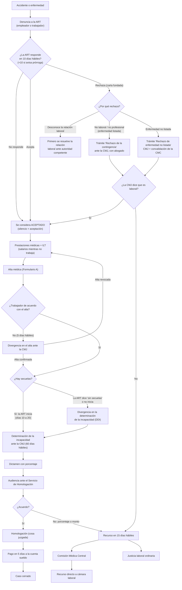

# Proceso de reclamo de un trabajador contra una ART

Investigación normativa para MyCase · Proyecto de portfolio UX/UI

- **Fecha de consulta de todas las fuentes:** 15 de octubre de 2026.
- **Alcance:** accidente de trabajo o enfermedad profesional de un trabajador en relación de dependencia registrado, con empleador asegurado en una ART, en una provincia **adherida** a la Ley 27.348 (es el caso más común). Las diferencias para provincias no adheridas están en [Bifurcaciones](#provincia-no-adherida).
- **Aviso:** este documento no es asesoramiento legal. Es un relevamiento de normas para diseñar un producto. Los plazos y requisitos cambian (en 2025 y 2026 hubo varias reformas) y cada caso concreto lo tiene que evaluar un abogado.

---

## Resumen en una frase

El trabajador denuncia el accidente, la ART tiene 10 días hábiles para aceptarlo o rechazarlo; si lo acepta lo atiende y le paga el sueldo hasta el alta, y después una comisión médica oficial fija el porcentaje de incapacidad y se firma un acuerdo que la ART paga en 5 días. Si la ART rechaza, o si hay desacuerdo con el alta o con el porcentaje, el abogado lleva el caso a esa misma comisión médica y, si hace falta, a la Comisión Médica Central o a la justicia laboral.

---

## Cómo leer este documento (glosario mínimo)

| Término | Qué es, en criollo |
|---|---|
| **ART** | Aseguradora de Riesgos del Trabajo. La empresa de seguros que el empleador está obligado a contratar y que paga la atención médica y las indemnizaciones [1, art. 3]. |
| **Siniestro / contingencia** | El accidente o la enfermedad que se reclama. |
| **Denuncia** | El aviso formal a la ART de que pasó el accidente o apareció la enfermedad. No es una denuncia policial. |
| **Prestaciones en especie** | Todo lo que la ART tiene que dar que no es plata: médicos, remedios, prótesis, rehabilitación, traslados [1, art. 20]. |
| **Prestaciones dinerarias** | La plata: el sueldo mientras no puede trabajar y la indemnización final. |
| **ILT** (Incapacidad Laboral Temporaria) | El período en que el trabajador está de licencia por el accidente, no puede trabajar y cobra igual [1, arts. 7 y 13]. |
| **Alta médica** | El momento en que la ART dice "ya terminó el tratamiento". Se entrega en un formulario ("Formulario A") [9, art. 3]. |
| **Secuelas / incapacidad permanente (ILP)** | Lo que quedó dañado para siempre, medido en porcentaje (por ejemplo, 8 %) [1, art. 8]. |
| **Comisión Médica Jurisdiccional (CMJ)** | Oficina pública de la Superintendencia de Riesgos del Trabajo (SRT) con médicos y abogados que decide los desacuerdos y fija el porcentaje. No es un juzgado [1, art. 21; 7, art. 2]. |
| **Comisión Médica Central (CMC)** | La instancia de apelación de las comisiones médicas, con sede en CABA [12]. |
| **Servicio de Homologación** | La parte de la comisión médica que arma la audiencia de acuerdo y la "homologa" (la aprueba oficialmente) [2, art. 3 y Anexo I]. |
| **Dictamen** | La decisión escrita de la comisión médica. |
| **Patrocinio letrado** | Tener abogado. Ante la comisión médica es obligatorio en los trámites de la Ley 27.348 [2, art. 1; 6, art. 36]. |
| **Notificación fehaciente** | Un aviso del que queda prueba de que llegó (carta documento, telegrama, notificación electrónica oficial). |
| **Días hábiles administrativos** | Días de lunes a viernes no feriados. Salvo que se diga otra cosa, los plazos ante las comisiones médicas se cuentan así, desde el día siguiente a la notificación [6, art. 29; 8, art. 24]. |

---

## Hoja de ruta para el trabajador

Así se lo podría contar el abogado al cliente al inicio del caso. Los pasos con **[Te toca a vos]** son los que requieren que el trabajador haga algo. Los tiempos son aproximados: los plazos legales están en la versión técnica, y en la práctica pueden estirarse.

> Tiempos "aproximados": salen de sumar los plazos legales. La duración real (sobre todo del tratamiento) depende de la lesión y de cuánto se demore cada organismo; ese dato **no está verificado en fuente oficial** porque no hay estadísticas públicas de duración que hayamos podido consultar.

**Camino sin conflicto (la ART acepta y todos están de acuerdo con el porcentaje)**

1. **Avisar del accidente o la enfermedad. [Te toca a vos].**
   "Lo primero es que la ART se entere. Lo tiene que avisar tu empleador apenas sabe, pero si no lo hace, lo podés hacer vos: por la línea gratuita de la ART, por telegrama laboral gratuito, con una nota en la sucursal o directamente en la clínica de la ART. Guardá el número de siniestro y una copia de todo." *Tiempo: el mismo día o lo antes posible.*

2. **Esperar la respuesta de la ART.**
   "La ART tiene 10 días hábiles (unas dos semanas) para decir si acepta o rechaza. Puede pedir 10 días hábiles más, pero te lo tiene que avisar. Si no dice nada en ese plazo, se considera que aceptó." *Tiempo: hasta 2 a 4 semanas.*

3. **Atenderte con la ART. [Te toca a vos] (ir a los turnos).**
   "Mientras tanto la ART te tiene que atender gratis: médicos, remedios, estudios, kinesiología, prótesis y traslados. Es importante que vayas a todos los turnos, porque si faltás sin motivo te pueden suspender la plata." *Tiempo: desde el primer día hasta el alta.*

4. **Cobrar mientras no podés trabajar.**
   "Mientras estés de licencia por el accidente seguís cobrando: los primeros 10 días te los paga tu empleador y después la ART, con las mismas fechas que el sueldo. Esto puede durar como máximo 2 años." *Tiempo: todo el tratamiento.*

5. **Recibir el alta médica. [Te toca a vos] (avisarme enseguida).**
   "Cuando la ART considere que terminó el tratamiento te va a dar el alta en un formulario. Mandámelo apenas lo recibas: si no estás de acuerdo con el alta, tenemos solo 5 días hábiles para discutirla." *Tiempo: depende de la lesión.*

6. **La comisión médica mide lo que te quedó.**
   "Si te quedaron secuelas, la ART tiene que pedir turno en la comisión médica, que es una oficina del Estado con médicos que no son de la ART. Ellos revisan los papeles y, si hace falta, te citan para revisarte o te piden un estudio. Después escriben un dictamen con el porcentaje de incapacidad." *Tiempo: la ART tiene que iniciarlo entre 10 y 20 días hábiles después del alta; la comisión tiene 60 días hábiles (unos 3 meses) para resolver, con una posible prórroga.*

7. **Audiencia de acuerdo. [Te toca a vos] (presentarte, con DNI).**
   "Con el porcentaje, el Estado calcula cuánto te corresponde y nos citan a una audiencia de acuerdo, que puede ser presencial o virtual. Tenés que estar vos, yo y la ART. Si estamos de acuerdo, se firma y el acuerdo queda aprobado oficialmente." *Tiempo: unos días a semanas después del dictamen.*

8. **Cobrar la indemnización.**
   "Una vez aprobado el acuerdo, la ART tiene 5 días hábiles para depositarte la plata en tu cuenta sueldo." *Tiempo: 1 semana.*

9. **Fin del caso.**

**Si la ART rechaza (camino más conflictivo, muy común según las entrevistas)**

2b. **Te llega el rechazo. [Te toca a vos] (mandarme la carta apenas llega).**
   "Si la ART rechaza, te lo tiene que avisar por un medio que deje constancia, normalmente una carta documento. Tiene que explicar por qué. Guardá el sobre y la carta." *Tiempo: dentro de los 10 a 20 días hábiles desde la denuncia.*

3b. **Vamos a la comisión médica.**
   "Con el rechazo en la mano, yo inicio el trámite en la comisión médica. Hay que presentar de entrada todas las pruebas: la denuncia, el rechazo, tu historia clínica y estudios, testigos si hubo. Atenderte, mientras tanto, lo podés hacer por tu obra social." *Tiempo: la comisión tiene 60 días hábiles para resolver, con prórroga posible.*

4b. **La comisión decide si fue laboral.** Si dice que sí, la ART tiene que darte todo lo de los pasos 3 a 8. Si dice que no, podemos apelar.

**Si no estamos de acuerdo con el alta o con el porcentaje**

- **Con el alta:** "Si te dan el alta y todavía estás mal, en 5 días hábiles pedimos que la comisión médica te revise. Si la comisión dice que el alta estuvo mal, se anula y sigue el tratamiento."
- **Con el porcentaje:** "Si en la audiencia el porcentaje nos parece bajo, no firmamos. Queda constancia y tenemos 15 días hábiles para apelar ante la Comisión Médica Central o ante la justicia laboral."

---

## Versión técnica para el abogado

Plazos en días hábiles administrativos salvo que se indique otra cosa [6, art. 29; 8, art. 24]. "CMJ" = Comisión Médica Jurisdiccional; "SH" = Servicio de Homologación.

### Tabla por etapa

| # | Etapa | Quién actúa | Plazo legal | Norma | Documentos | Bifurcaciones |
|---|---|---|---|---|---|---|
| 1 | **Denuncia** | Empleador (obligado), o el trabajador, derechohabientes o cualquier tercero que sepa del hecho | Empleador: "inmediatamente de conocido". El derecho a las prestaciones nace con la denuncia | Dto. 717/96 art. 1 [4]; LRT art. 31.2.c y 31.3.e [1]; LRT art. 43 [1] | Denuncia escrita con relato de los hechos, identificación de las partes y firma (si no la hace el empleador). En enfermedad profesional: síntomas, puesto y tareas habituales [10, art. 2] | Se puede presentar ante la ART o ante un prestador, que la remite a la ART en 24 h [4, arts. 3-4]. La ART no puede negarse a recibirla [4, art. 6] |
| 2 | **Aceptación o rechazo** | ART | 10 días desde la recepción, prorrogables 10 más con notificación fehaciente de la prórroga dentro de los primeros 10. El silencio equivale a aceptación | Dto. 717/96 art. 6 (texto Dto. 1475/2015) [4]; la SRT los informa como hábiles [18] | Rechazo notificado fehacientemente al trabajador y al empleador, y fundado [4, art. 6 bis; 8, art. 8 (texto Res. 9/2018)] | Causales cerradas de rechazo: (a) empleador desconoce la relación laboral; (b) dolo del trabajador, fuerza mayor ajena al trabajo, o incapacidad preexistente acreditada en el preocupacional; (c) accidente no laboral o enfermedad no profesional [4, art. 6; 1, art. 6.3]. Dar prestaciones antes de decidir no implica aceptación [4, art. 6] |
| 3 | **Prestaciones en especie** | ART (prestadores) | Inmediatas desde la denuncia, mientras no haya rechazo; hasta la curación o mientras subsistan síntomas | Dto. 717/96 arts. 4-5 [4]; LRT art. 20 [1] | Turnos, órdenes, historia clínica | Negativa injustificada del trabajador a tratarse: la ART puede pedir a la CMJ la suspensión de las prestaciones dinerarias (trámite "Abandono de tratamiento") [1, art. 20.2; 4, art. 10.2]. Desacuerdo con el tratamiento: "Divergencia en las prestaciones" ante la CMJ, presencial o por Mesa de Entradas Virtual [8, Anexo I 9.1; 23] |
| 4 | **ILT** (salarios de licencia) | Empleador los primeros 10 días; ART desde el día 11 | Mensual, en el plazo y forma del pago de remuneraciones. Cesa por alta, declaración de ILP, muerte o 2 años desde la primera manifestación invalidante | LRT arts. 7 (texto Ley 27.348 art. 10) y 13 [1; 2] | Recibos | Recaídas dentro de los 2 años: se suman los períodos hasta 2 años efectivos [1, art. 7.3; 6, art. 42] |
| 5 | **Alta médica** | ART | Notificación fehaciente del alta con Formulario A; aviso al empleador al día hábil siguiente. Excepción: alta con tratamiento pendiente (odontología, psicoterapia, dermatología) y Formulario B al terminarlo | Res. SRT 1838/2014 arts. 1-5 [9]; formularios con datos mínimos modificados por Res. SRT 20/2026 [31] | Formulario A "Constancia de Alta Médica" (incluye si hay secuelas, Sí/No, y la leyenda de los 5 días para discrepar) | **Divergencia en el alta:** 5 días hábiles desde la notificación, ante la CMJ [9, art. 7]. Vencidos, se puede pedir **reingreso a tratamiento** a la ART, que responde en 10 días corridos (Formulario C); si lo deniega, trámite ante la CMJ [9, art. 8] |
| 6 | **Inicio de la determinación de incapacidad** | ART (si hay secuelas) o trabajador (si la ART no inicia o dice "sin secuelas") | ART: entre el día 10 y el 20 desde el día siguiente al cese de la ILT. Si no lo hace en 20 días, el trabajador puede iniciar la **Divergencia en la Determinación de la Incapacidad (DDI)**. Accidentes sin baja: la ART tiene 20 días desde la aceptación | Res. SRT 298/2017 arts. 3-4 [6]; Res. SRT 899-E/2017 art. 4.2-4.3 [7]; Res. SRT 9/2018 art. 3 [10] | "Informe del caso" de la ART (denuncia, historia clínica, estudios, protocolo quirúrgico, en EP relevamiento de riesgos, alta, preexistencias, CBU de cuenta sueldo, opción de CMJ) [6, art. 4]. Desde el 2/2/2026: formularios obligatorios de inicio (incapacidad, rechazo de accidente, rechazo de EP, prestaciones) [15, art. 4] | Opción de CMJ del trabajador: domicilio, lugar de trabajo o lugar donde se reporta; la ART lo intima a elegir en 3 días hábiles o queda la del domicilio del DNI [2, art. 1; 6, art. 5]. La DDI se inicia en forma remota (e-Servicios SRT) en provincias adheridas [19] |
| 7 | **Trámite ante la CMJ** | Médico de la CMJ; Secretario Técnico Letrado si hay cuestiones jurídicas | 60 días hábiles desde la "primera presentación debidamente cumplimentada" (con patrocinio letrado). Prórroga fundada, una sola vez, de hasta 30 días hábiles. Demoras imputables a las partes suspenden el plazo. Vencido el plazo, queda expedita la vía recursiva | Ley 27.348 art. 3 [2]; Res. SRT 298/2017 arts. 6, 7 (texto Res. 5/2026), 29, 32 y 36 [6; 15] | Toda la prueba se ofrece y acompaña en la primera presentación; si el trabajador se atendió por obra social, tiene que acompañar esa historia clínica [6, art. 7] | El médico puede resolver con los papeles, pedir estudios, interconsulta o citar a examen físico [6, art. 6; 28]. Peritos de parte a cargo de quien los propone [6, art. 7]. Incomparecencia injustificada del trabajador: 15 días corridos para instar el trámite; a la segunda, cierre sin agotar la instancia [6, arts. 34-35] |
| 8 | **Dictamen** | CMJ | Notificación a las partes y al empleador en 3 días. Rectificación o revocación del dictamen: 3 días desde la notificación; el médico responde en 5 | Res. SRT 298/2017 arts. 9-10 [6] | Dictamen médico con porcentaje según la Tabla de Evaluación de Incapacidades (Dto. 659/96, actualizada por Dto. 549/2025) [6, art. 23; 15, considerandos] | Dictamen "sin secuelas" en una DDI: el SH pregunta a la ART si quiere ofrecer una compensación económica (3 días hábiles); si no, disposición de clausura y vía recursiva abierta [14, arts. 2-4] |
| 9 | **Audiencia ante el SH y homologación** | SH (funcionario letrado), trabajador con su abogado, ART | Citación con al menos 3 días de antelación. Asistencia obligatoria. Acto de homologación en 5 días. Audiencias virtuales habilitadas por Res. SRT 53/2026 (B.O. 15/10/2026, vigente desde el día siguiente) | Ley 27.348 Anexo I art. 2 [2]; Res. SRT 298/2017 arts. 10-15 [6]; Res. SRT 53/2026 [16] | Liquidación mínima calculada por la SRT con salarios declarados al SUSS [6, art. 11]. Acta. En la audiencia se deja constancia de la opción del art. 4 de la Ley 26.773 [6, art. 13]. En la virtual, el acta se firma electrónicamente en 48 h [16, Anexo pto. 7] | Conformidad → homologación con cosa juzgada administrativa [2, art. 2 y Anexo I art. 4]. Disconformidad con el **porcentaje** → acta y vía recursiva [6, art. 14]. Disconformidad con el **monto** → se puede acordar uno mayor; si no, vía judicial [6, art. 15]. Incomparecencia de la ART: acto de clausura y vía recursiva para el trabajador [6, art. 34.b] |
| 9 bis | **Acuerdo directo previo** (variante) | ART propone; trabajador firma con su abogado | Dentro del mismo plazo para iniciar la determinación (arts. 19-20). Si el SH no lo homologa, en 5 días se inicia la determinación de incapacidad | Ley 27.348 Anexo I art. 3 [2]; Res. SRT 298/2017 arts. 19-27 [6] | Formulario propuesta de convenio; Informe de Valoración del Daño (IVD) del médico de la CMJ [6, art. 23] | Nunca se homologa un monto menor al legal ni un porcentaje distinto del IVD [6, art. 26]. Alta sin secuelas: la ART puede proponer un acuerdo de compensación económica sin porcentaje [14, art. 1] |
| 10 | **Pago** | ART | Notificar importes en 15 días desde la homologación o determinación [3, art. 4]. Poner a disposición la indemnización en 5 días desde la notificación del acto de homologación, en la cuenta sueldo [2, Anexo I art. 4; 2, art. 17; 6, art. 13] | Ley 26.773 art. 4 [3]; Ley 27.348 Anexo I art. 4 [2] | Depósito en cuenta sueldo | Mora: interés tasa activa BNA con capitalización semestral [1, art. 12.3]. Cobrar implica ejercer la opción por el sistema tarifado (no se puede después ir por la vía civil) [3, art. 4]; cobrar ILT o recibir prestaciones no implica esa opción [3, art. 5] |
| 11 | **Recursos** | Cualquiera de las partes | 15 días desde la notificación del acto del SH, por escrito y fundado; traslado de 5 días; elevación en 10 días | Ley 27.348 art. 2 [2]; LRT art. 46 [1]; Res. SRT 298/2017 arts. 16-18 [6] | Expresión de agravios con crítica concreta y razonada [6, art. 16] | El trabajador elige: **CMC** o **justicia laboral ordinaria** del domicilio de la CMJ. El recurso del trabajador a la justicia "atrae" el de la ART a la CMC. Efecto suspensivo, salvo apelaciones de la ART en enfermedad no listada o reagravamiento (devolutivo) [2, art. 2] |
| 12 | **Comisión Médica Central** | CMC | 45 días hábiles sin prueba; 90 con prueba (prorrogables). Aclaratoria o rectificación: 3 días. Su decisión es recurrible por recurso directo ante la cámara laboral | Res. SRT 7/2023 Anexo ptos. 5.2, 6.1 y 6.2 [12]; Ley 27.348 art. 2 [2] | Solo se admite prueba denegada en la instancia anterior [12, pto. 3.1] | Examen físico en CABA obligatorio si se cita; la ART paga traslado y estadía [12, pto. 3.3]. Lo que nadie recurre queda firme [12, pto. 7] |
| — | **Prescripción** | — | 2 años desde que la prestación debió pagarse o darse y, en todo caso, 2 años desde el cese de la relación laboral | LRT art. 44 [1]; para la vía civil, desde la notificación del art. 4 Ley 26.773 [3] | — | — |

### Datos complementarios

- **Honorarios del abogado del trabajador ante la CMJ:** a cargo de la ART, solo si el trabajador va con abogado particular y la pretensión se reconoce total o parcialmente; no se regulan en la comisión médica [2, art. 1; 6, art. 37]. Si el trabajador no tiene abogado, la SRT provee patrocinio gratuito [6, art. 36; 21]. En los juicios del Título I de la Ley 27.348 está prohibido el pacto de cuota litis [2, art. 2].
- **Gratuidad para el trabajador:** el procedimiento, los traslados, los estudios y la prueba son gratuitos [1, art. 21.4; 2, art. 2].
- **Indemnización por incapacidad permanente parcial definitiva de hasta el 50 %:** pago único = 53 × ingreso base mensual × porcentaje × (65 ÷ edad) [1, art. 14.2.a], con pisos que la SRT actualiza por RIPTE cada semestre (Res. SRT 39/2026 para sept. 2026 a feb. 2027) [1, notas Infoleg], más un 20 % adicional si el daño ocurrió en el lugar de trabajo o a disposición del empleador (no en el trayecto) [3, art. 3]. Para MyCase esto importa poco: el producto no debería mostrar montos salvo que el abogado lo decida (ver insights).
- **Divergencias sobre el salario:** la CMJ liquida con los salarios declarados al SUSS. Si hay salarios en negro, esa discusión va a la justicia, sin frenar el cobro de lo declarado [7, art. 5].
- **Ley 27.802 (Modernización Laboral, B.O. 6/3/2026):** no cambia el circuito ante las comisiones médicas. Agrega el art. 4 bis a la Ley 27.348: las jurisdicciones adheridas tienen que aplicar estrictamente la Tabla de Evaluación de Incapacidades y tener cuerpos médicos forenses o peritos con entornos digitales de la SRT en 90 días [17, art. 154]. También modifica las normas de peritos médicos de la justicia nacional del trabajo [17, art. 78].

---

## Bifurcaciones

### Diagrama general

### Rechazo de la ART

- **Qué pasa:** la ART notifica fehacientemente el rechazo al trabajador y al empleador, con fundamento [4, arts. 6 y 6 bis]. Para que el rechazo esté "debidamente fundado" la ART tiene que apoyarse en evaluación médica, estudios, investigación del accidente o mapa de riesgos (en enfermedades), según el caso [8, art. 8 en el texto de la Res. 9/2018; 10, art. 4].
- **Carta documento:** las normas exigen notificación "fehaciente", no un medio específico. Que llegue por carta documento es lo habitual según la entrevista con la Abogada 2, pero **no está verificado en fuente oficial que sea el único medio**.
- **Qué hace el abogado:** inicia "Rechazo de la denuncia de la contingencia" ante la CMJ con DNI, denuncia, rechazo, relato de los hechos y toda la prueba [6, art. 1; 7, art. 6; 15]. Se corre traslado a la ART por 5 días hábiles; el Secretario Técnico Letrado produce la prueba y emite un dictamen jurídico previo sobre si el accidente es laboral [7, art. 6; 1, art. 21.5]. Después interviene el médico y el SH dicta el acto [6, art. 2].
- **Si el rechazo es porque el empleador niega la relación laboral:** la comisión médica no lo resuelve; va primero a la autoridad competente [4, arts. 6.a y 11]. Si el trabajador **no estaba registrado** y el empleador no tenía ART, no está obligado a pasar por la comisión médica: tiene la vía judicial directa [2, art. 1].
- **Mientras dura:** la ART no da prestaciones (solo las debía hasta el rechazo [4, art. 5]); el trabajador se atiende por obra social y la ART después le reintegra a la obra social lo que esté cubierto [2, art. 18].

### Silencio de la ART

- Si pasan 10 días (o 20 con prórroga notificada) sin rechazo fehaciente, la denuncia **se tiene por aceptada** [4, art. 6].
- El antiguo trámite "Silencio de la ART" ante la comisión médica fue derogado en 2022; los reclamos por falta de respuesta a una denuncia van por el Registro de Seguimiento de Reclamos de la SRT (Res. SRT 733/08) [11, arts. 2 y 5]. Canales de reclamo: línea 0800-666-6778 y formulario web de la SRT [23].
- Para la app: el silencio no es un paso propio sino una forma de pasar a "aceptado". Conviene que el abogado pueda marcarlo como tal.

### Divergencia en el alta

- **Cuándo:** el trabajador recibe el alta y sigue con síntomas o cree que el tratamiento no terminó.
- **Plazo:** 5 días hábiles desde la notificación del alta [9, art. 7]. Es el plazo más corto y el más fácil de perder: por eso el abogado le pide al cliente que le mande el Formulario A apenas lo reciba.
- **Trámite:** presencial ante la CMJ o por la Mesa de Entradas Virtual [8, Anexo I 9.1; 23]. La SRT deriva al trabajador a un médico; si la divergencia no se resuelve, la CMJ sustancia el trámite en 5 días [4, art. 14; 8, art. 3]. Si la CMJ considera inadecuada el alta, se revoca y sigue la ILT [9, art. 7].
- **Si ya pasaron los 5 días:** pedir reingreso a tratamiento a la ART (responde en 10 días corridos); si lo deniega, trámite ante la CMJ [9, art. 8].
- **Patrocinio letrado:** la página de la SRT lista como obligatorio el abogado solo para rechazo, enfermedad no listada, DDI y COVID [21]; la divergencia en el alta y en las prestaciones se rigen por la Res. 179/2015 y el Dto. 717/96, que también exige abogado "conforme lo determine la SRT" [4, art. 12]. **Ver Dudas abiertas.**

### Divergencia en el porcentaje

- **Ante la ART:** si la ART dice "sin secuelas" o no inicia la determinación en 20 días, el trabajador inicia la **DDI** [6, art. 3; 7, art. 4.3]. Si el dictamen confirma "sin secuelas", la ART puede ofrecer una compensación económica; si no la ofrece, se dicta la clausura y queda abierta la vía recursiva [14; 13].
- **Ante la comisión médica:** si en la audiencia alguna parte no está de acuerdo con el porcentaje del dictamen, se labra acta y queda abierta la vía recursiva [2, Anexo I art. 2; 6, art. 14]. Antes de llegar ahí, dentro de los 3 días del dictamen se puede pedir rectificación de errores o revocación por contradicción [6, art. 10].
- **Recurso:** 15 días hábiles. El trabajador elige CMC o justicia laboral ordinaria [2, art. 2; 6, arts. 16-18]. Si la ART apela a la CMC y el trabajador va a la justicia, la CMC se inhibe [12, pto. 2.2].
- **Tabla de incapacidades:** desde 2025 rige una Tabla de Evaluación de Incapacidades actualizada (Dto. 549/2025) [15, considerandos; 28], y la Ley 27.802 obliga a las jurisdicciones adheridas a aplicarla estrictamente también en sede judicial [17, art. 154].

### Enfermedad no listada

- **Regla:** solo son enfermedades profesionales las del listado oficial (Dto. 658/96). Las no listadas se reconocen caso por caso si la Comisión Médica Central determina que las causó directamente el trabajo, excluyendo factores del trabajador o ajenos al trabajo [1, art. 6.2.a y 6.2.b].
- **Trámite:** el trabajador presenta ante la CMJ una "petición fundada" con diagnóstico, argumentación, estudios y descripción de los agentes de riesgo a los que estuvo expuesto, más la denuncia y el rechazo de la ART [6, art. 1; 1, art. 6.2.b.i].
- **Doble paso:** si la CMJ entiende que la enfermedad encuadra, la ART tiene que dar prestaciones desde ese momento y la CMJ pide a la CMC que convalide o rectifique; la CMC tiene 30 días. Si la CMC convalida, fija también el porcentaje; si no, la ART deja de dar prestaciones [1, art. 6.2.c].
- **Efecto del recurso:** si la ART apela ese caso a la CMC, el recurso no suspende la obligación de dar prestaciones (efecto devolutivo) [2, art. 2.a].
- Es el camino más incierto y largo: conviene modelarlo como una rama aparte en la app.

### Provincia no adherida

- **Qué es la adhesión:** la Ley 27.348 invita a las provincias y a CABA a adherir. Adherir significa delegar en la jurisdicción nacional (las comisiones médicas de la SRT) la instancia previa obligatoria y el esquema de recursos [2, art. 4]. La Corte Suprema convalidó ese sistema en "Behrens c/ Asociart" (2024) y antes en "Pogonza" [27].
- **Qué cambia si la provincia adhirió:**
  - La comisión médica es **obligatoria y excluyente** antes de cualquier juicio, con abogado [2, art. 1].
  - Rige el procedimiento de la Res. SRT 298/2017 (plazo de 60 días, Servicio de Homologación, recurso en 15 días) [6, arts. 40-41].
  - Las homologaciones y los dictámenes no recurridos hacen cosa juzgada administrativa [2, art. 2].
- **Qué cambia si no adhirió:**
  - No rige la obligatoriedad del Título I de la Ley 27.348. Los trámites ante la comisión médica siguen el Dto. 717/96 y la Res. SRT 179/2015 [6, art. 40; 8].
  - Los dictámenes se apelan con otros plazos: el Dto. 717/96 dice 5 días [4, art. 26] y el manual de la Res. 179/2015 dice 10 días [8, Anexo I pto. 22.c]. **Ver Dudas abiertas.**
  - Las decisiones de la CMC se revisan por recurso directo ante la cámara laboral, y si apela la ART, la CMC remite la apelación al juzgado competente [12, ptos. 2.2 y 6.2.1].
  - Que el trabajador pueda ir **directo a juicio sin pasar por la comisión médica** en una provincia no adherida es la consecuencia práctica habitual, pero no la encontramos dicha en forma expresa en una norma oficial: surge de que la delegación de competencias solo opera por adhesión [2, art. 4]. **No verificado en fuente oficial como texto expreso.**
- **Mapa según la SRT** (buscador de comisiones médicas de srt.gob.ar, archivo del mapa con fecha de modificación 9/6/2025) [23]:
  - **Adheridas (en verde):** Buenos Aires, Chaco, Chubut, Córdoba, Corrientes, Entre Ríos, Formosa, Jujuy, Mendoza, Misiones, Neuquén, Río Negro, Salta, San Juan, San Luis, Santa Fe y Tierra del Fuego.
  - **No adheridas (en azul):** Catamarca, La Pampa, La Rioja, Santa Cruz, Santiago del Estero y Tucumán.
  - **CABA** no figura en el mapa. **Ver Dudas abiertas.**
  - Hitos recientes confirmados por la SRT: Chubut adhirió en diciembre de 2024 como la "decimoctava" jurisdicción [24]; Jujuy entró en plena vigencia por convenio en agosto de 2025 [32]; Neuquén reglamentó su adhesión (Dto. provincial 1618, Ley 3.141) en diciembre de 2025 [25]; La Pampa estaba "avanzando" en octubre de 2025 [26].
  - Adherir no siempre significa que funcione enseguida: la SRT tiene 90 días desde que se cumplen los requisitos para habilitar el procedimiento en la provincia [6, art. 38], y hay provincias que adhirieron por ley y entraron en "plena vigencia" después, por convenio o reglamentación [25; 32].

---

## Implicancias para el diseño de MyCase

### Pasos de la hoja de ruta (propuesta)

Los nombres van en lenguaje del cliente. Entre paréntesis, el término técnico que el abogado reconoce.

| # | Paso en la app | ¿Predecible? | ¿Acción del cliente? | Plazo que la app puede mostrar |
|---|---|---|---|---|
| 1 | Avisamos a la ART (denuncia) | Sí | A veces (si el empleador no denunció) | Fecha de denuncia |
| 2 | La ART decide si acepta (aceptación o rechazo) | El plazo sí; el resultado no | No | 10 días hábiles (+10). Se puede calcular la fecha límite |
| 3 | Tratamiento con la ART (prestaciones e ILT) | No en duración | Sí: ir a los turnos | Máximo 2 años |
| 4 | Te dieron el alta (alta médica) | No en fecha | **Sí: mandar el Formulario A ya** | **5 días hábiles para discrepar** (alerta clave) |
| 5 | La comisión médica evalúa (determinación de incapacidad) | Sí | A veces: examen o estudios | ART inicia en 10-20 días hábiles; CMJ resuelve en 60 días hábiles (+30) |
| 6 | Salió el dictamen | Sí | No | Notificación en 3 días; 3 días para pedir corrección |
| 7 | Audiencia de acuerdo (Servicio de Homologación) | Sí | **Sí: presentarse con DNI, presencial o virtual** | Citación con 3 días de antelación |
| 8 | Acuerdo aprobado (homologación) | Sí | No | 5 días |
| 9 | Cobro | Sí | No (opcional: confirmar que llegó) | 5 días desde la homologación |
| 10 | Caso cerrado | — | — | — |

Ramas opcionales que el abogado activa cuando pasan:

- **R1. La ART rechazó** → "Vamos a la comisión médica por el rechazo" (acción del cliente: mandar la carta de rechazo y la historia clínica de la obra social).
- **R2. No estamos de acuerdo con el alta** → "Pedimos que te revise la comisión médica".
- **R3. La ART dice que no quedaron secuelas** → "Pedimos que la comisión médica mida tu incapacidad" (DDI).
- **R4. No aceptamos el porcentaje** → "Apelamos" (con dos sub-caminos: Comisión Médica Central o juzgado laboral).
- **R5. Enfermedad no listada** → rama larga con doble paso CMJ y CMC.

### Qué es predecible y qué varía

- **Muy predecible:** el orden de los pasos, los nombres de las etapas, los plazos legales cortos (10 días para la ART, 5 días para discrepar del alta, 15 días para apelar, 5 días para pagar) y los documentos que intervienen. Esto respalda el insight de la Abogada 2 de que en ART "siempre pasa lo mismo".
- **Predecible en forma, incierto en resultado:** aceptación o rechazo, alta con o sin secuelas, conformidad o no con el porcentaje. La app puede anticipar las dos salidas posibles ("te pueden rechazar; si pasa, hacemos esto").
- **Variable:** la duración del tratamiento, los tiempos reales de la comisión médica (los 60 días se suspenden por demoras de las partes y se pueden prorrogar), y si la provincia está adherida o no.
- **Depende de la provincia:** el circuito completo. La provincia (o la comisión médica elegida) debería ser un dato del caso que cambie la plantilla de hoja de ruta.

### Estados que conviene modelar

- **Estado de cada paso:** pendiente · en curso · cumplido · omitido (por ejemplo, "silencio de la ART" cumple el paso 2 sin respuesta expresa) · vencido (plazo pasado sin acción).
- **Resultado de los pasos que bifurcan:** paso 2 = aceptado / aceptado por silencio / rechazado (con motivo: no laboral, no listada, relación laboral desconocida, otro). Paso 4 = alta con secuelas / alta sin secuelas / alta con tratamiento pendiente. Paso 7 = acuerdo / desacuerdo por porcentaje / desacuerdo por monto / incomparecencia.
- **Plazos con fecha de vencimiento calculada en días hábiles:** la app ya descuenta feriados nacionales (ver el commit "Descontar feriados nacionales en los plazos en días hábiles"), así que puede calcular el vencimiento de los 10, 5 y 15 días. Conviene mostrarlos como estimados y dejar que el abogado los corrija, porque el cómputo depende de la fecha de notificación real.
- **Bandera "Te toca a vos":** un booleano por paso para distinguir lo que espera del cliente de lo que espera de la ART o de la comisión médica.
- **Instancia actual:** ART · Comisión Médica Jurisdiccional · Servicio de Homologación · Comisión Médica Central · Justicia laboral. Sirve para responder la pregunta "¿dónde está mi caso?".
- **Tipo de contingencia:** accidente de trabajo · accidente in itinere (en el trayecto; no lleva el 20 % adicional [3, art. 3]) · enfermedad listada · enfermedad no listada.
- **Jurisdicción:** adherida / no adherida, que define la plantilla.
- **Documentos clave asociados a pasos:** denuncia y número de siniestro, carta de rechazo, Formulario A (alta), Formulario B (fin de tratamiento), Formulario C (reingreso), dictamen, acta de audiencia, acto de homologación, comprobante de depósito.

### Alertas de plazo que valen oro para la credibilidad del abogado

1. Alta recibida → 5 días hábiles para discrepar.
2. Denuncia hecha → la ART tiene 10 días hábiles (anticipar "puede llegar un rechazo").
3. Alta sin secuelas o la ART no inicia → desde el día 21 se puede iniciar la DDI.
4. Acto del Servicio de Homologación sin acuerdo → 15 días hábiles para apelar.
5. Homologación → la ART tiene 5 días para pagar ("si no llegó, avisame").

---

## Fuentes

Todas consultadas el 15/10/2026. Para verificar la vigencia se revisaron los textos actualizados de Infoleg y argentina.gob.ar/normativa y las listas de "normas que la modifican" [29; 30; 31].

1. **Ley 24.557 de Riesgos del Trabajo**, texto actualizado (incluye cambios de Dto. 1278/2000, Ley 26.773, Ley 27.348, Dto. 669/2019 y notas de Res. SRT 39/2026). Infoleg. https://servicios.infoleg.gob.ar/infolegInternet/anexos/25000-29999/27971/texact.htm
2. **Ley 27.348**, complementaria de la LRT (B.O. 24/2/2017), con Anexo I del Servicio de Homologación. Infoleg. https://servicios.infoleg.gob.ar/infolegInternet/anexos/270000-274999/272119/norma.htm
3. **Ley 26.773**, régimen de ordenamiento de la reparación, texto actualizado. Infoleg. https://servicios.infoleg.gob.ar/infolegInternet/anexos/200000-204999/203798/texact.htm
4. **Decreto 717/96**, texto actualizado (con cambios del Dto. 1475/2015). argentina.gob.ar. https://www.argentina.gob.ar/normativa/nacional/norma-37813/actualizacion
5. **Decreto 1475/2015**, modificatorio del Dto. 717/96. argentina.gob.ar. https://www.argentina.gob.ar/normativa/nacional/norma-249821/texto
6. **Resolución SRT 298/2017**, procedimiento ante las comisiones médicas (Ley 27.348), texto actualizado al 2/2/2026 (Res. SRT 5/2026, 90/2019, 20/2021). argentina.gob.ar. https://www.argentina.gob.ar/normativa/nacional/norma-272121/actualizacion
7. **Resolución SRT 899-E/2017**, disposiciones aclaratorias de la Res. 298/2017. argentina.gob.ar. https://www.argentina.gob.ar/normativa/nacional/norma-287178/texto
8. **Resolución SRT 179/2015**, procedimiento y manual de trámites ante las comisiones médicas, texto actualizado. argentina.gob.ar. https://www.argentina.gob.ar/normativa/nacional/norma-241264/actualizacion
9. **Resolución SRT 1838/2014**, alta médica, fin de tratamiento y reingreso (Formularios A, B y C), texto actualizado. argentina.gob.ar. https://www.argentina.gob.ar/normativa/nacional/norma-233039/actualizacion
10. **Resolución SRT 9/2018**, procedimiento para el rechazo de enfermedades profesionales. argentina.gob.ar. https://www.argentina.gob.ar/normativa/nacional/norma-315273/texto
11. **Resolución SRT 41/2022**, deroga el trámite "Silencio de la ART". Infoleg. https://servicios.infoleg.gob.ar/infolegInternet/anexos/365000-369999/368412/norma.htm
12. **Resolución SRT 7/2023**, procedimiento ante la Comisión Médica Central. argentina.gob.ar. https://www.argentina.gob.ar/normativa/nacional/norma-378915/texto
13. **Disposición GACM 6/2021**, DDI por cese de ILT sin secuelas. argentina.gob.ar. https://www.argentina.gob.ar/normativa/nacional/norma-357852/texto
14. **Resolución SRT 41/2025**, acuerdos de compensación económica en casos sin secuelas (B.O. 22/9/2025). argentina.gob.ar. https://www.argentina.gob.ar/normativa/nacional/norma-417816/texto
15. **Resolución SRT 5/2026**, modifica Res. 179/2015, 298/2017 y 899/2017; formularios obligatorios de inicio (B.O. 29/1/2026, vigente desde 2/2/2026). argentina.gob.ar. https://www.argentina.gob.ar/normativa/nacional/norma-422732/texto
16. **Resolución SRT 53/2026**, audiencias virtuales ante el Servicio de Homologación (B.O. 15/10/2026). argentina.gob.ar. https://www.argentina.gob.ar/normativa/nacional/norma-431258/texto
17. **Ley 27.802 de Modernización Laboral** (B.O. 6/3/2026), Título XVIII y art. 78. argentina.gob.ar. https://www.argentina.gob.ar/normativa/nacional/norma-423680/texto
18. SRT, **"Qué hacer ante un accidente laboral o enfermedad profesional"**. https://www.argentina.gob.ar/srt/trabajadores/que-hacer-ante-un-accidente-laboral
19. SRT, **"Cuándo solicitar intervención de las Comisiones Médicas"**. https://www.argentina.gob.ar/srt/trabajadores/cuando-solicitar-intervenci%C3%B3n-de-las-comisiones-medicas
20. SRT, **"Comisiones Médicas - Trámites"**. https://www.argentina.gob.ar/srt/comisionesmedicas/tramites
21. SRT, **"Patrocinio letrado"**. https://www.argentina.gob.ar/srt/patrocinio-letrado
22. SRT, **"Prestaciones médicas"**. https://www.argentina.gob.ar/srt/trabajadores/prestaciones-medicas
23. SRT, **Buscador de Comisiones Médicas y mapa de adhesión** (y su archivo de mapa `Argentina.kml`, modificado el 9/6/2025). https://www.srt.gob.ar/arg/mapa.php · https://www.srt.gob.ar/arg/argenmap/Argentina.kml
24. SRT, **"Chubut adhirió a la Ley 27.348"** (20/12/2024). https://www.argentina.gob.ar/noticias/chubut-adhirio-la-ley-27348
25. SRT, **"Neuquén reglamentó su adhesión a la Ley 27.348..."** (9/12/2025). https://www.argentina.gob.ar/noticias/neuquen-reglamento-su-adhesion-la-ley-27348-y-habilito-la-plena-actuacion-de-las-comisiones
26. SRT, **"La Pampa avanza en la adhesión a la Ley 27.348"** (28/10/2025). https://www.argentina.gob.ar/noticias/la-pampa-avanza-en-la-adhesion-la-ley-27348
27. SRT, **"La Corte Suprema ratificó el rol de las comisiones médicas establecido en la ley 27.348"** (11/11/2024, fallo "Behrens"). https://www.argentina.gob.ar/noticias/la-corte-suprema-ratifico-el-rol-de-las-comisiones-medicas-establecido-en-la-ley-27348
28. SRT, **"Simplificación de los trámites ante las Comisiones Médicas"** (30/4/2026, Res. 5/26 y Dto. 549/2025). https://www.argentina.gob.ar/noticias/simplificacion-de-los-tramites-ante-las-comisiones-medicas
29. argentina.gob.ar, **normas que modifican o complementan la Ley 27.348**. https://www.argentina.gob.ar/normativa/nacional/norma-272119/normas-modifican
30. argentina.gob.ar, **normas que modifican o complementan la Res. SRT 298/2017**. https://www.argentina.gob.ar/normativa/nacional/norma-272121/normas-modifican
31. argentina.gob.ar, **normas que modifican o complementan la Ley 24.557** (incluye Res. SRT 20/2026 sobre los formularios de alta y fin de tratamiento, y Res. SRT 39/2026). https://www.argentina.gob.ar/normativa/nacional/norma-27971/normas-modifican
32. SRT, **"La Ley 27.348 entra en plena vigencia en Jujuy"** (7/8/2025). https://www.argentina.gob.ar/noticias/la-ley-27348-entra-en-plena-vigencia-en-jujuy

No se usaron blogs de estudios jurídicos. La única afirmación que sale de una fuente no normativa es la de la carta documento (entrevista con la Abogada 2, en `docs/entrevistas/abogada-2.md`).

---

## Dudas abiertas

1. **Lista exacta de jurisdicciones adheridas a octubre de 2026.** El mapa de la SRT es de junio de 2025 y no incluye a CABA. No confirmamos en fuente oficial la ley de adhesión de CABA, ni si La Pampa, Catamarca, Tucumán o Santiago del Estero adhirieron después. Antes de usar la provincia como regla en la app, hay que validarla con una abogada o con la SRT (0800-666-6778).
2. **Vía judicial directa en provincias no adheridas.** Es la consecuencia práctica de no adherir, pero no la encontramos en el texto expreso de una norma oficial. Depende también de la jurisprudencia de cada provincia. **No verificado en fuente oficial.**
3. **Plazo de apelación de los dictámenes fuera del procedimiento de la Ley 27.348** (divergencia en el alta y en las prestaciones, y provincias no adheridas): el Dto. 717/96 art. 26 dice 5 días y el manual de la Res. SRT 179/2015 dice 10 días. No pudimos determinar cuál prevalece en la práctica.
4. **Patrocinio letrado en divergencia en el alta y en las prestaciones.** La página de la SRT no lo lista como obligatorio para esos trámites, pero el Dto. 717/96 art. 12 lo exige "conforme lo determine la SRT". No quedó claro si es obligatorio.
5. **Carta documento como medio de notificación del rechazo.** La norma exige notificación "fehaciente" sin fijar el medio. Que sea carta documento sale de la entrevista, **no de una fuente oficial**.
6. **Duraciones reales.** No encontramos estadísticas oficiales de cuánto tarda en promedio cada etapa (tratamiento, comisión médica, CMC). Los "tiempos aproximados" de la hoja de ruta son sumas de plazos legales, no mediciones.
7. **Texto completo de los cambios de 2026.** Revisamos las Res. SRT 5/2026 y 53/2026, pero no el contenido de los anexos con los formularios (Res. 5/2026) ni el detalle de la Res. SRT 20/2026 sobre los Formularios A y B. Tampoco la vigencia exacta del baremo del Dto. 549/2025 respecto de casos en curso.
8. **Reglamentación de la Ley 27.802.** El art. 4 bis de la Ley 27.348 da 90 días a las jurisdicciones adheridas para implementar peritos y entornos digitales. No verificamos qué provincias cumplieron ni si hubo reglamentación que cambie el trámite.
9. **Incapacidades altas (más del 50 %, total o gran invalidez) y fallecimiento.** Tienen pagos periódicos, intervención de ANSES y derechohabientes. Quedaron fuera del detalle de este documento porque no son el caso típico del MVP.
10. **Domicilio electrónico y notificaciones.** Las notificaciones al trabajador van al domicilio electrónico que constituye su abogado (e-Servicios SRT) [6, art. 28; 20]. No relevamos en detalle la Res. SRT 82/2020 ni la Res. SRT 22/2018, que regulan esas notificaciones. Esto puede importar para integrar avisos en la app en el futuro.
